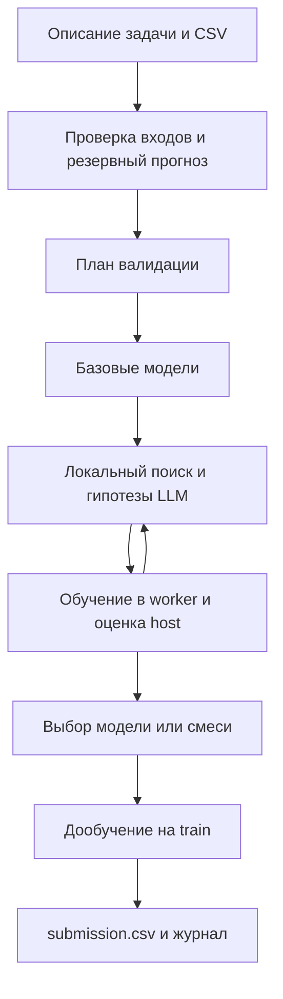

# Как разобраться в проекте и подготовиться к собеседованию

## Что делает программа

Это не одна модель качества вина или энергопотребления. Это программа, которая получает новую табличную задачу и организует серию экспериментов: какие признаки использовать, какую модель обучить и какую конфигурацию выбрать при ограниченном времени.

Например, в train.csv есть характеристики здания и известное энергопотребление, а в test.csv — такие же характеристики без ответа. Агент должен обучиться и записать прогноз для каждой строки test. В другом запуске целевая переменная может быть классом сетевой атаки. Одна кодовая база обслуживает разные поддерживаемые постановки.

LLM предлагает гипотезу вроде «проверить балансировку классов». Обычный Python-код обучает модель и считает метрику. LLM не предсказывает каждую строку и не назначает себе score. В offline-режиме работает предусмотренный локальный поиск без вызовов LLM.

## Где код, где инструменты

Основная программа находится в `universal_agent/automl_agent/`. `solution.py` — вход; `tests/` проверяет поведение; `scripts/` содержит отдельные команды сравнения, упаковки и проверки запусков; `docs/` хранит решения и исторические измерения. Обычно пользователь запускает solution.py, а не каждый файл по очереди. Большое число модулей объясняется разделением ответственности.

## Учебный маршрут

Не нужно читать весь agent.py подряд в первый день. На каждом этапе разберите один пример и попробуйте объяснить его своими словами.

| Этап | Файлы относительно universal_agent/ | Что должен уметь объяснить |
|---|---|---|
| 1. Контракт | solution.py, automl_agent/config.py, data.py, contracts.py | Что приходит на вход, что такое target и ID, что должно оказаться в submission |
| 2. Проверка качества | validation.py, evaluation.py, cv_worker.py | Train/validation/test, holdout/CV/OOF, временные и групповые данные, почему нельзя обучаться на контрольных метках |
| 3. Один эксперимент | recipes.py, families.py, features.py, training.py | Разница алгоритма и гиперпараметра, fit/transform, early stopping и refit |
| 4. Исследователь | agent.py, search.py, prompts.py, providers.py | Какие решения принимает host и какие предлагает LLM; путь одной принятой и одной отклонённой гипотезы |
| 5. Ресурсы и сбои | runtime.py, scheduler.py, budgeting.py, journal.py | Зачем отдельный процесс, deadline, fallback и резерв финального обучения |
| 6. Личный вклад | postprocessing.py; docs/reviews/ruzik_update_85f4988.md | Как binary F1 зависит от порога, почему важны ties и positive class, зачем календарные признаки |
| 7. Доказательства | docs/VALIDATION.md, AGENT_COMPARISON.md; scripts/verify_run.py | Какие результаты реальные, какой у них протокол и чего они не доказывают |

У файлов выше предполагается общий префикс `universal_agent/automl_agent/`, кроме явно отмеченных entrypoint/docs/scripts. Можно использовать эти имена для поиска внутри проекта.

## Понятия на примере проекта

- **Holdout:** часть известных ответов откладывают и проверяют прогноз на ней. Она не должна участвовать в обучении этого опыта.
- **CV:** несколько таких разбиений уменьшают зависимость оценки от одного выбора строк.
- **OOF:** прогноз каждой проверяемой строки получен моделью, которая не обучалась на этой строке. Для forward CV ранние периоды могут остаться без прогноза.
- **Утечка:** информация, недоступная при реальном прогнозе, помогает обучению или выбору модели. Например, одинаковые объекты попали и в fit, и в validation, хотя требуется обобщение на новые объекты. Допустимость повторов зависит от постановки.
- **RMSE:** корень из средней квадратичной ошибки численного прогноза, в единицах цели. Меньше лучше; число 0.66 на качестве вина нельзя сравнивать с 32 на энергопотреблении.
- **Macro F1:** среднее F1 по классам с одинаковым весом каждого класса. Ошибки на редких классах тоже существенно влияют на итог.
- **Threshold:** правило превращения вероятности положительного класса в метку, например p>=0.4. Оно меняет F1, но не сам ROC AUC по исходным вероятностям.
- **Refit:** после выбора конфигурации её заново обучают на полном доступном train для итогового прогноза.

Даже OOF не даёт независимой итоговой оценки, если по нему многократно выбирали модели. Внешний evaluator проекта оценивает финальный CSV по отложенным меткам отдельно от внутреннего поиска.

## Как говорить о своём вкладе

Исходные коммиты ветки ruzik: 1ee7bdf, 639aa2d, 85f4988. Они не перенесены сюда целиком. Текущий код — итоговая командная main099f8cb; перенос собственных идей зафиксирован в PROVENANCE и повторном аудите Ruzik. Не называйте все файлы Universal лично написанными.

Пока вы не разобрали конкретную функцию, лучше сказать «работал над этим блоком с AI-помощником, сейчас могу объяснить его контракт и проверки», чем утверждать самостоятельную реализацию с нуля. Цель обучения — уметь показать функцию и объяснить её решения, а не выучить красивое описание.

## Вопросы для самопроверки

1. Чем этот агент отличается от одного обученного CatBoost?
2. Кто считает метрику и почему нельзя доверить её текстовому ответу LLM?
3. Почему случайный split опасен для временного прогноза?
4. Где обучаются частоты категорий и почему нельзя считать их по всей таблице?
5. Что будет при ошибке API или нехватке времени на refit?
6. Почему число экспериментов и HTTP-запросов само по себе не измеряет качество?
7. Что именно перенесено из вашей версии и где это подтверждено?
8. Какое улучшение не сработало? Почему результаты разных протоколов нельзя сравнивать напрямую?

## Как пользоваться прежними файлами контекста

`PORTFOLIO_PROJECT_AUDIT.md` — снимок разбора на 08.11 до создания самостоятельного публичного репозитория; его сведения о планируемом fork исторические. `CHATGPT_PROJECT_HANDOFF.md` — большой старый контекст для нового чата. `CHATGPT_PROJECT_CONTEXT.zip` — архив исходников и документов двух версий, а не ещё один проект и не обязательный файл для запуска агента.

Теперь предпочтительнее дать ChatGPT публичную ссылку на этот репозиторий и [новый учебный промпт](CHATGPT_STUDY_PROMPT.md). Архив нужен только если ChatGPT не может прочитать файлы GitHub. В нём старые снимки: main099f8cb и ruzik85f4988, а не нынешнее оформление README.

## Границы результатов

В командном отчёте сохранены 543 успешных теста и внешние сравнения, но они не запускались заново при оформлении этого репозитория. Полный трёхчасовой soak Universal и официальный hidden score не подтверждены. Локальный Wine запуск кода Олега с трёхчасовым бюджетом сам завершился примерно за 7 минут; не выдавайте его за трёхчасовой тест своей версии.
